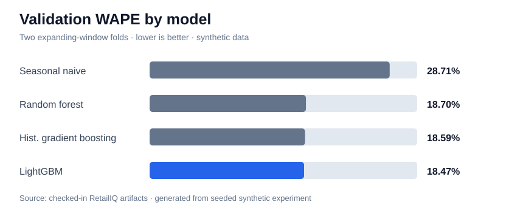
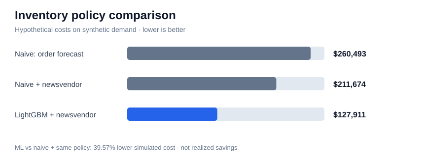

# RetailIQ — Retail Demand Forecasting & Inventory Optimization
**This project predicts how much of each product a store will sell each day, then tests whether better predictions lead to better ordering decisions. On simulated data, the best model cut forecast error from 28% to 17% and cut simulated inventory costs by about 40% compared with a simple baseline using the same ordering rule.
**Forecast daily store–product demand and turn those predictions into inventory decisions.** RetailIQ combines a leakage-aware forecasting pipeline, temporal backtesting, SQL processing, and an interactive Streamlit dashboard. It compares machine-learning forecasts against a seasonal-naive baseline, then evaluates an illustrative cost-sensitive replenishment policy.

**Data:** Deterministic synthetic retail demand; no proprietary or employer data is included. All financial outcomes are hypothetical simulations, not real savings.

## Results at a glance

**Synthetic, one-step-ahead historical backtest.** Lag features use observed prior-day latent demand, so these numbers do **not** represent recursive multi-day forecasting.

| Forecast reference | Validation WAPE | Same-period holdout WAPE |
| --- | ---: | ---: |
| Seasonal naive (lag 7) | 28.71% | **28.02%** |
| Random forest | 18.70% | — |
| Histogram gradient boosting | 18.59% | — |
| **LightGBM (selected)** | **18.47%** | **17.43%** |
| Oracle: true simulator expected demand | — | **15.74%** |

**LightGBM holdout:** MAE **4.15**, RMSE **5.32**, mean forecast bias **+0.64** across **5,664** store–product–day observations (Dec 27, 2024–Feb 23, 2025). LightGBM won by lowest mean validation WAPE, but the three ML candidates are close; the results do not establish a statistically significant ranking. The oracle knows the synthetic demand-generating mean and is **not deployable**.

### Inventory impact under matched policies

| Inventory policy | Hypothetical cost | Stockout units |
| --- | ---: | ---: |
| Seasonal naive, order the forecast | $260,493 | 16,339 |
| Seasonal naive + newsvendor safety stock | $211,674 | 7,920 |
| **LightGBM + the same newsvendor rule** | **$127,911** | **2,636** |

**Incremental simulated cost reduction from the ML forecast: 39.57%** versus naive + newsvendor (a difference of **$83,763**). Adding the policy alone reduces the naive cost by **18.74%**. The combined reduction against ordering the naive forecast directly is **50.90%**, but **that is not the model-only effect**.





*Limitations:* All data and dollar figures are simulated. Demand is known in the simulator but would be censored by stockouts in real sales. Inventory uncertainty is heuristic, not calibrated; no lead times, ordering constraints, or deployment behavior are modeled. These are illustrative scenario costs, **not actual savings**.

## Quick start

```bash
python -m venv .venv
source .venv/bin/activate  # Windows: .venv\\Scripts\\activate
pip install -e '.[dev,boost]'
retailiq --out artifacts
pytest -q
streamlit run dashboard.py
```

LightGBM is optional; without it, install `pip install -e '.[dev]'`. Model selection may then change.

## Business problem

A multi-store retailer needs to estimate daily demand at the store–SKU level and make replenishment decisions. Forecasting demand alone is not enough: understocking and overstocking have different costs. RetailIQ compares several forecast models and evaluates an illustrative inventory decision rule against a seasonal-naive baseline.

## Architecture

```text
Deterministic simulator → CSV + SQLite (SQL aggregation)
                      ↓
Point-in-time features (lags, rolling windows, calendar, pricing)
                      ↓
Expanding-window validation → model selection → final temporal holdout
                      ↓
One-step-ahead predictions → newsvendor inventory simulation
                      ↓
Saved artifacts → interactive Streamlit dashboard
                      ↓
pytest + GitHub Actions CI + Docker deployment configuration
```

## Model design

- **Targets:** `latent_demand`, which is visible only because the dataset is simulated. In real retail data, sales are often censored by stockouts; this target would require a defensible demand-estimation strategy.
- **Features:** 1/7/14/28-day demand lags, 7/28-day trailing means and standard deviations, store and product IDs, price, promotion, holiday, and calendar attributes. All demand-derived features use **prior dates only**.
- **Models:** seasonal naive (`lag_7`), random forest, histogram gradient boosting, and **optional** LightGBM.
- **Validation:** two expanding-window validation folds, select lowest mean WAPE, retrain on all pre-test history, evaluate on a strictly later test period. No random splitting of time-series rows.
- **Metrics:** WAPE, MAE, RMSE, mean forecast bias. Validation metrics and final holdout metrics are saved separately.
- **Forecasting scope:** the holdout is a **one-step-ahead historical backtest** that uses actual previous-day demand to form lag features. It is **not** a recursive multi-step deployment forecast, and future covariate availability is not simulated.

## Inventory policy

For an estimated demand mean μ and heuristic standard deviation σ, the order-up-to level is

`Q = max(0, ceil(μ + Φ⁻¹(Cu / (Cu + Co)) · σ))`

where `Cu` is the unit underage penalty and `Co` the unit overage penalty. Defaults: **$12** and **$3** per unit, respectively. Uncertainty is an **assumed heuristic** `max(2, sqrt(predicted demand))`, not a calibrated prediction interval. The baseline orders the prior week's same-day demand (`lag_7`). Both policies are evaluated on the **same synthetic realized demand**. This comparison excludes lead times, minimum order quantities, fixed ordering costs, service-level guarantees, and supply-chain constraints.

## Docker

```bash
docker build -t retailiq .
docker run --rm -p 8501:8501 retailiq
```

Open `http://localhost:8501`.

## Repository layout

```text
src/retailiq/       synthetic generation, SQL, features, training, inventory, CLI
artifacts/          example metrics, predictions, inventory comparisons (generated)
tests/              reproducibility, leakage, SQL, inventory and pipeline tests
dashboard.py        Streamlit visualizations and filters
pyproject.toml      installable package + dependencies
.github/workflows/  CI testing
Dockerfile          reproducible dashboard container
```

## What these results do—and do not—show

- **Why WAPE?** It aggregates absolute forecast errors relative to aggregate demand, avoiding the division-by-zero instability of per-row MAPE on low or zero demand. It still emphasizes high-volume series.
- **Why temporal validation?** Random splits would let later observations influence model selection for earlier dates. Every demand-derived lag or rolling feature uses observations strictly before the forecast date.
- **Why the critical ratio?** In the single-period newsvendor model, the optimal demand quantile balances the marginal underage penalty against the marginal overage penalty: `Cu / (Cu + Co)`.
- **Why heuristic σ?** `max(2, sqrt(predicted demand))` is a deliberately simple scale assumption for a demonstration; it is **not** calibrated to residuals or a prediction interval. Consequently, inventory cost comparisons should not be treated as validated operational policy improvements.
- **What is not evaluated?** Recursive forecasts, stockout-censored observed sales, lead times, real-world demand uncertainty, and deployment drift.

## Technical limitations and next steps

1. Replace synthetic data with properly licensed public retail data and handle censored sales.
2. Implement **recursive multi-horizon forecasting** with known-in-advance covariates, and rolling-origin evaluation at the requested horizon.
3. Add quantile or conformal prediction intervals and calibrate uncertainty before inventory optimization.
4. Incorporate lead times, supplier constraints, lost-sales dynamics, and a true sequential inventory simulation.
5. Add MLflow experiment tracking, drift monitoring, scheduled retraining, and cloud deployment.

**Ethics:** No customer-level personally identifiable information is generated or processed. This is a learning/demo system, not a production retail planning tool.
